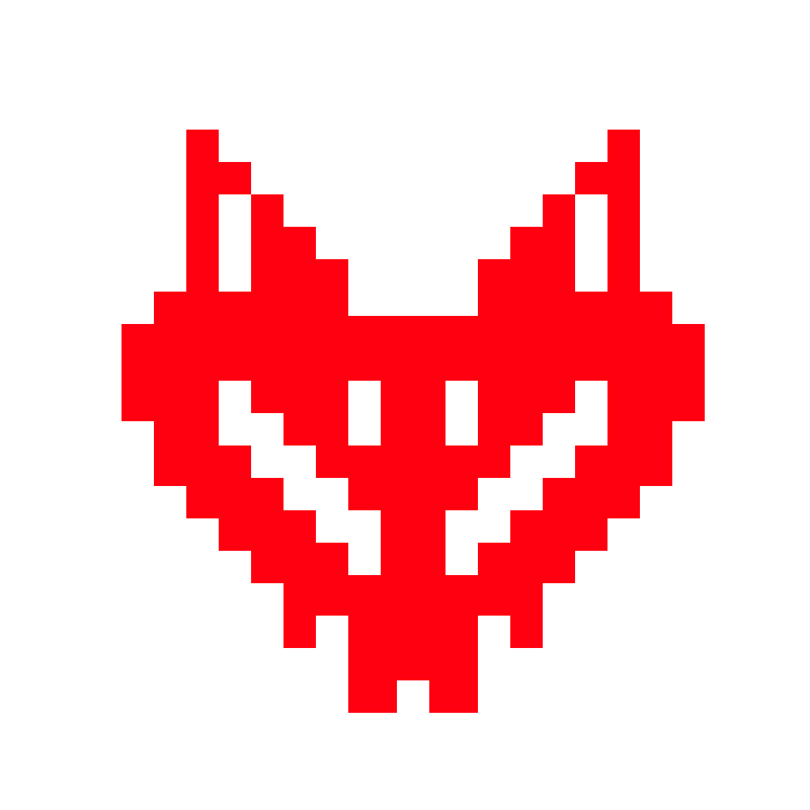

<div align="center">



# Nyrax

**Nimble Yet Rigorous Application eXaminer**

*A deterministic DAST orchestrator for web application security.*

[](https://github.com/benosons/nyrax-release/releases)
[](https://github.com/benosons/nyrax-release/releases)
[](https://www.typescriptlang.org/)
[](https://bun.sh/)
[](./LICENSE)
[](#install)

</div>

---

Nyrax is a single-binary CLI (`nyx`) that scans web applications for vulnerabilities. It runs its own
built-in scanner as a zero-dependency floor, and orchestrates best-in-class external tools
(nuclei, sqlmap, dalfox, katana, …) when they are installed — then merges everything into one
reproducible report.

Unlike LLM-agent scanners, Nyrax is **deterministic**: the same scan gives the same result, costs
nothing per run, and is cheap enough to gate every CI build.

## Install

```bash
# Linux / macOS
curl -fsSL https://github.com/benosons/nyrax-release/releases/latest/download/install.sh | bash

# Windows (PowerShell)
irm https://github.com/benosons/nyrax-release/releases/latest/download/install.ps1 | iex
```

No runtime required — the installer downloads a prebuilt standalone binary. The built-in engine
scans on its own; optional external tools add depth (`nyx doctor` shows what's installed).

### Option: Docker (all tools included)

For full depth without installing Go/Python/Ruby tools yourself, use the all-in-one image — every
scanner Nyrax orchestrates is bundled:

```bash
docker build -t nyrax .
docker run --rm -v "$PWD:/work" nyrax scan https://example.com -o report.html
```

The report lands in the mounted folder. This is just an option; the standalone binary above is the
default path.

## Usage

```bash
nyx scan https://example.com                     # standard scan, HTML report
nyx scan example.com -p quick -o report.sarif    # quick scan, SARIF output
nyx scan https://app.example.com \
  -H "Authorization: Bearer <token>"               # authenticated scan
nyx scan https://api.example.com \
  --openapi ./openapi.json                          # import endpoints + JSON bodies
nyx scan https://app.example.com \
  -c "session=A" --cookie-b "session=B"             # access-control (IDOR/BOLA) test
nyx scan https://example.com --fail-on high       # exit 2 if any high+ finding (CI gate)
nyx doctor                                         # show which scanners are installed
nyx doctor --install                               # install the Go-based scanners
```

Profiles: `quick`, `standard`, `deep`. Report format follows the `-o` extension
(`.html`, `.md`, `.json`, `.sarif`); default is a timestamped HTML file.

## What it detects

Built-in engine (no external tools needed):

- SQL injection — error-based, boolean-blind, and time-based
- Cross-site scripting — reflected, context-aware (HTML body / attribute / unquoted)
- Server-side template injection (SSTI)
- OS command injection (time-based)
- Path traversal / local file inclusion
- CRLF / HTTP response header injection
- Open redirect
- Broken access control (IDOR/BOLA) — with a second session
- CORS misconfiguration (landing page and API endpoints)
- TLS issues — expired/untrusted certificates, deprecated protocols
- Exposed files (`.git`, `.env`, actuator, dumps, …), security-header gaps, cookie flags, version disclosure

Crawling & discovery: redirect-following depth-limited BFS, GET and POST forms, endpoint mining from
JS bundles, OpenAPI/Swagger/Postman import, content discovery (ffuf) and hidden-parameter discovery
(arjun). Installed external tools add depth automatically — nuclei, sqlmap, dalfox, nikto, testssl,
katana, httpx, subfinder, ffuf, arjun, and wpscan (run only when the target looks like WordPress).

## Authorization & legal

Nyrax sends real attack payloads (SQL quotes, template expressions, sleep injections, traversal
sequences). **Only scan systems you own or are explicitly authorized to test.** Scanning without
permission is illegal in most jurisdictions. By default the tool refuses `localhost`, private IP
ranges, and internal hostnames; use `--allowlist`/`--denylist` to scope engagements.

## Development

```bash
bun install
bun test              # test suite
bunx tsc --noEmit     # typecheck
bun run build.ts      # build the standalone binary
```

## Roadmap

Planned: SSRF (out-of-band), SPA/DOM XSS via optional headless crawl, and a hosted API mode with
accounts/credits. See the capability roadmap for details.

## Support

If Nyrax saves you time, you can support its development:

[-Saweria-FAAC2B.svg)](https://saweria.co/benosons)
[-Ko--fi-FF5E5B.svg?logo=ko-fi&logoColor=white)](https://ko-fi.com/benosons)

## Credits

Nyrax is an orchestrator — much of its depth comes from established open-source scanners it runs
(nuclei, sqlmap, dalfox, katana, httpx, subfinder, nikto, testssl.sh) and the MIT libraries bundled
into the binary. Those tools are invoked as separate programs and keep their own licenses. See
[CREDITS.md](./CREDITS.md) for full attribution and the licensing relationship.

## License

Nyrax is licensed under [AGPL-3.0](./LICENSE). Third-party tools and libraries remain under their
own licenses (see [CREDITS.md](./CREDITS.md)).
